# MarsEnergy 3D

Procedural 3D assets for the MarsEnergy project. This repository contains 12 binary glTF 2.0 models, 12 matching transparent PNGs, and 13 renders of Mars bases, equipment, and cargo scenes.

## Source and outputs

| Generator | Output directory | Format |
| --- | --- | --- |
| [Python modeling and C++ rendering](scripts/custom_assets/) | [Standalone models](assets/renders/custom/) | GLB and 2400 × 1600 transparent PNG |
| [Chromium renderer](scripts/render_plates.py) with [JavaScript scene sources](src/) | [Scene renders](assets/renders/) | 1400 × 880 PNG |

### Standalone models

Pass `--asset` more than once to select several asset groups. The `greenhouse` and `geology` groups each produce a pair of models rendered from the same camera.

| `--asset` | Model | GLB | Image |
| --- | --- | --- | --- |
| `lamp` | Desktop power kit with lamp and meter | [Model](assets/renders/custom/p0_desk_kit_lamp_meter.glb) | <a href="assets/renders/custom/p0_desk_kit_lamp_meter.png"></a> |
| `teg` | Desktop power kit with thermoelectric module and heat sink | [Model](assets/renders/custom/p0_desk_kit_teg_heatsink.glb) | <a href="assets/renders/custom/p0_desk_kit_teg_heatsink.png"></a> |
| `greenhouse` | B2 greenhouse cutaway, 25 kW / 12 h | [Model](assets/renders/custom/p0_b2_greenhouse_cutaway_25kw_12h.glb) | <a href="assets/renders/custom/p0_b2_greenhouse_cutaway_25kw_12h.png"></a> |
| `greenhouse` | B2 greenhouse cutaway, 15 kW / 8 h | [Model](assets/renders/custom/p0_b2_greenhouse_cutaway_15kw_8h.glb) | <a href="assets/renders/custom/p0_b2_greenhouse_cutaway_15kw_8h.png"></a> |
| `microgrid` | Modular microgrid bus interface | [Model](assets/renders/custom/p0_microgrid_bus_interface.glb) | <a href="assets/renders/custom/p0_microgrid_bus_interface.png">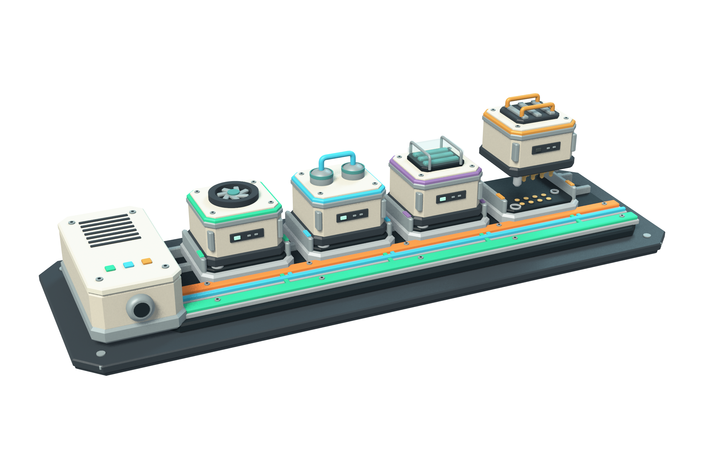</a> |
| `cubesat` | 1U CubeSat thermoelectric module | [Model](assets/renders/custom/p0_cubesat_1u_teg_module.glb) | <a href="assets/renders/custom/p0_cubesat_1u_teg_module.png">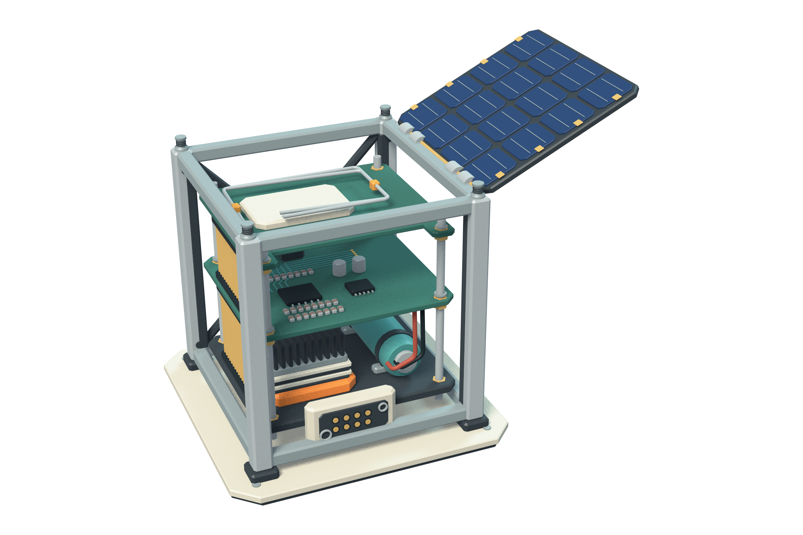</a> |
| `backup` | Zone A 48 h backup power cutaway | [Model](assets/renders/custom/p1_zone_a_backup_48h_cutaway.glb) | <a href="assets/renders/custom/p1_zone_a_backup_48h_cutaway.png">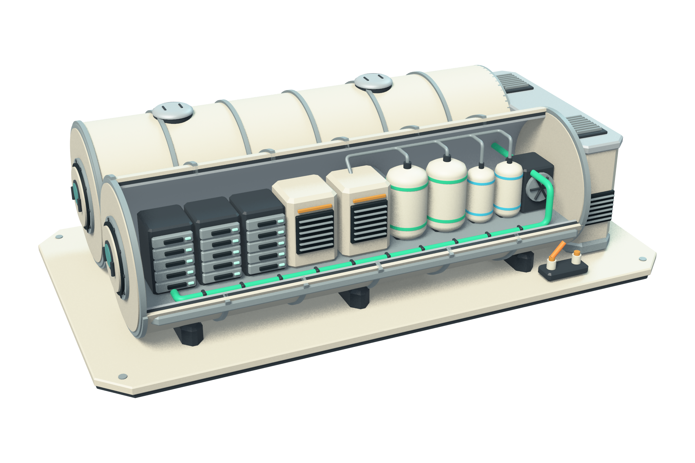</a> |
| `geology` | Zone C ice well at Utopia | [Model](assets/renders/custom/p1_zone_c_utopia_ice_well.glb) | <a href="assets/renders/custom/p1_zone_c_utopia_ice_well.png">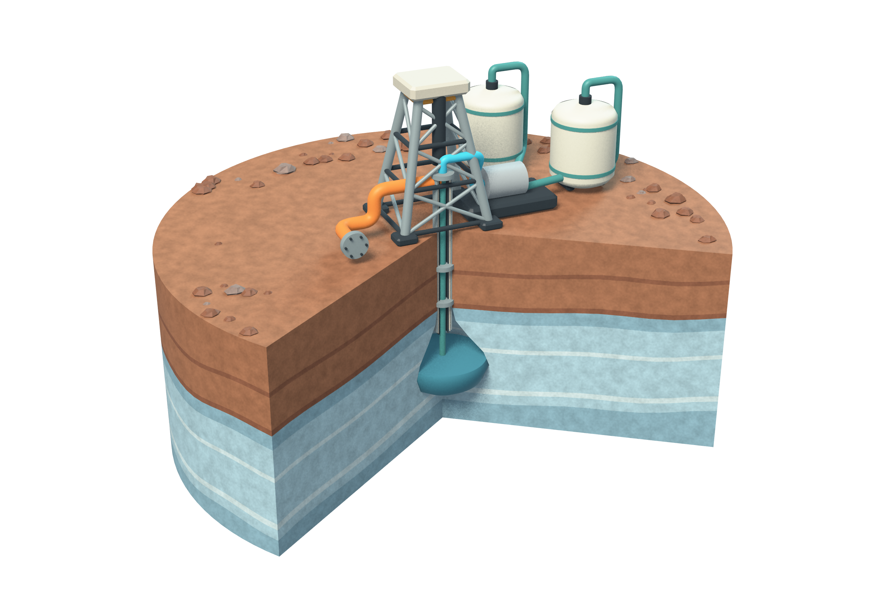</a> |
| `geology` | Zone C clay kiln at Gale | [Model](assets/renders/custom/p1_zone_c_gale_clay_kiln.glb) | <a href="assets/renders/custom/p1_zone_c_gale_clay_kiln.png"></a> |
| `cansat` | CanSat telemetry demonstration | [Model](assets/renders/custom/p1_cansat_rocket_telemetry.glb) | <a href="assets/renders/custom/p1_cansat_rocket_telemetry.png"></a> |
| `campus` | Campus blackout drill diorama | [Model](assets/renders/custom/p2_campus_blackout_diorama.glb) | <a href="assets/renders/custom/p2_campus_blackout_diorama.png">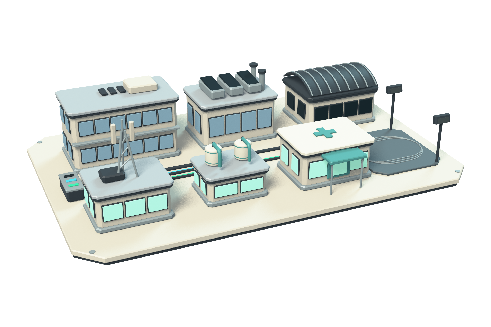</a> |
| [Separate generator](#regenerate-the-pwo3-cutaway) | pwO3 stellarator cutaway | [Model](assets/renders/custom/pwo3_stellarator_cutaway.glb) | <a href="assets/renders/custom/pwo3_stellarator_cutaway.png">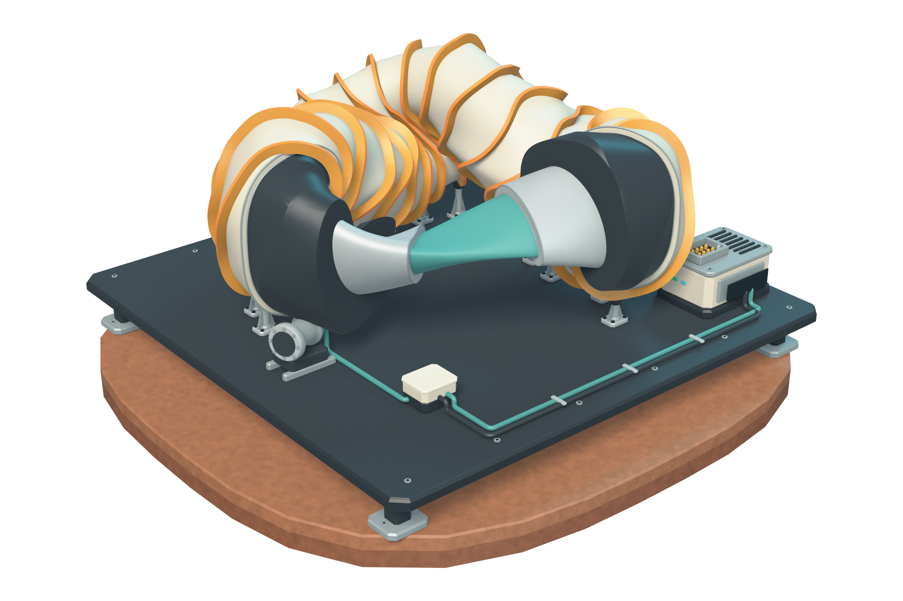</a> |

### Scene renders

| Scene | Image |
| --- | --- |
| Mars globe and Utopia site | <a href="assets/renders/01_mars_utopia_globe.png">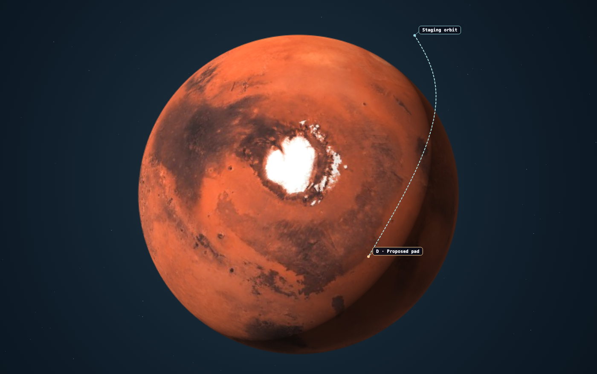</a> |
| Oblique view of Utopia base | <a href="assets/renders/02_utopia_base_oblique.png"></a> |
| Utopia base operating with four units | <a href="assets/renders/03_utopia_base_4units.png">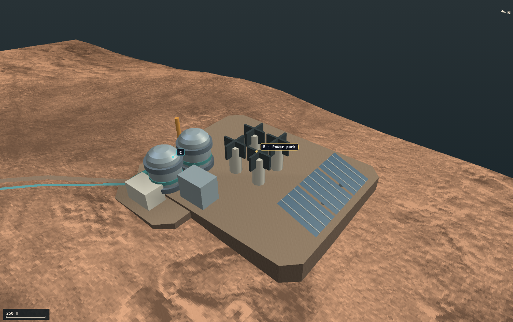</a> |
| Gale base and Bradbury Landing | <a href="assets/renders/04_gale_bradbury.png"></a> |
| B2 greenhouse | <a href="assets/renders/05_b2_greenhouse.png">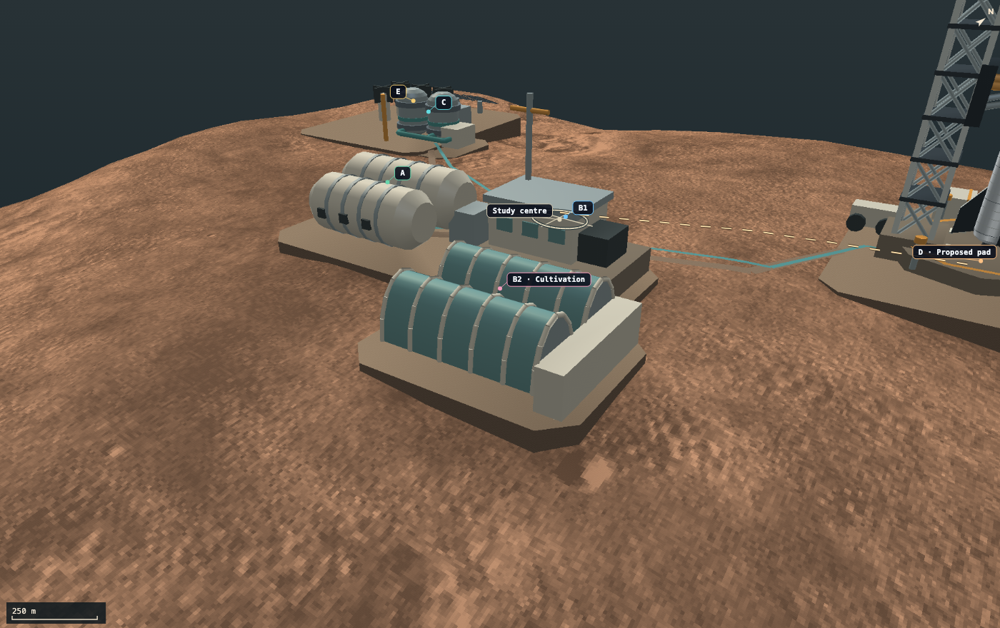</a> |
| P1 equipment in vertical configuration | <a href="assets/renders/06_p1_vertical.png"></a> |
| P1 equipment in umbrella configuration under dusty conditions | <a href="assets/renders/07_p1_umbrella_dust.png">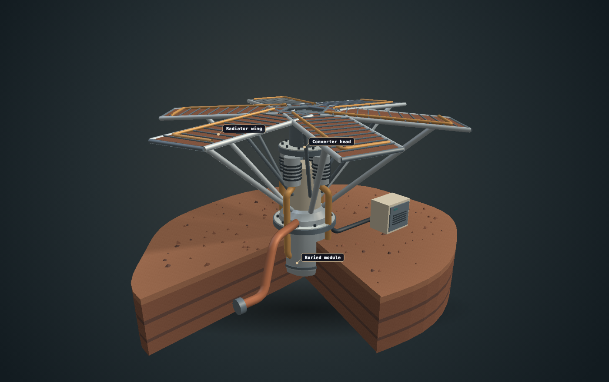</a> |
| P2 Brayton-cycle equipment | <a href="assets/renders/08_p2_brayton.png">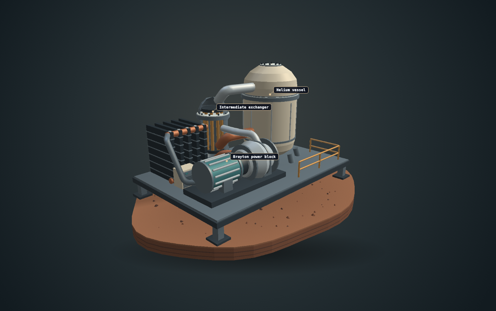</a> |
| DFR power station | <a href="assets/renders/09_dfr_station.png">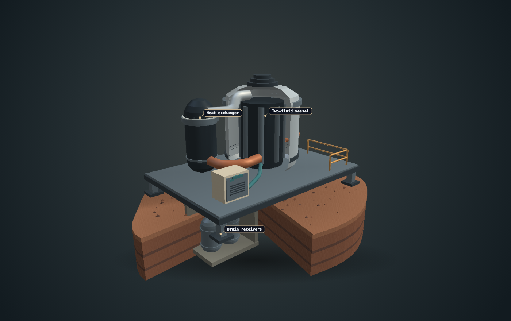</a> |
| Fusion power station | <a href="assets/renders/10_fusion_station.png"></a> |
| Zone D twin-arm tower | <a href="assets/renders/11_zone_d_tower.png">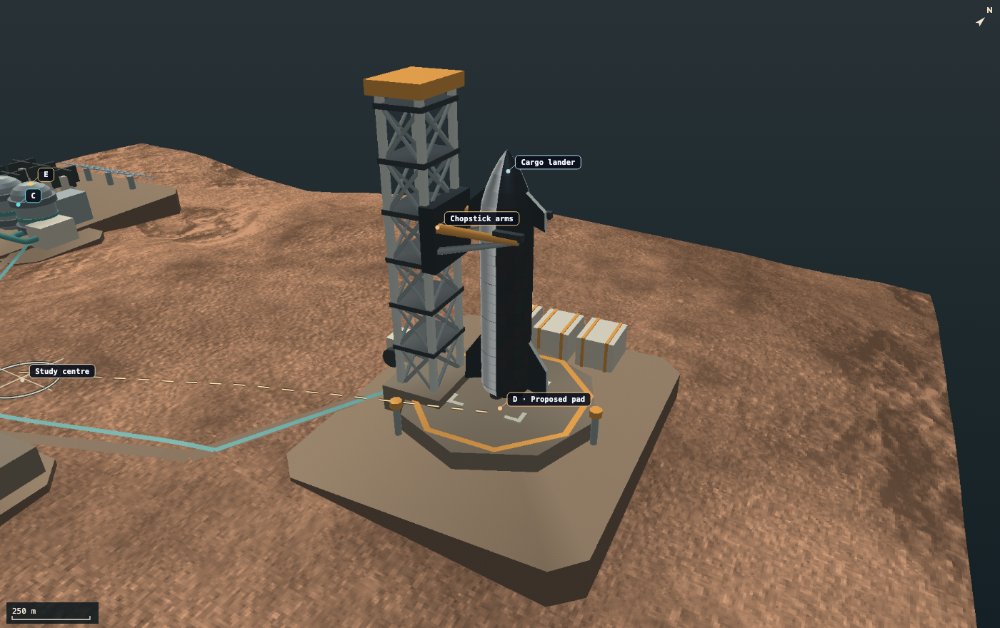</a> |
| Freighter cutaway | <a href="assets/renders/12_starship_cutaway.png">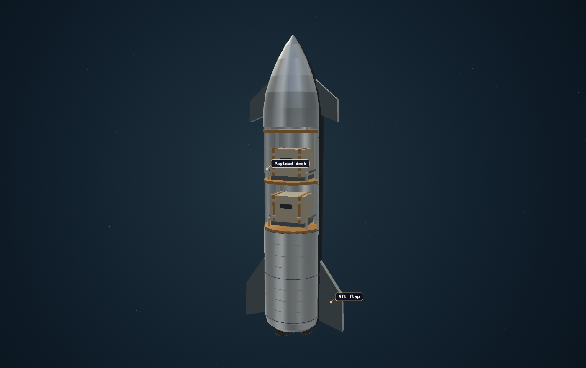</a> |
| Hohmann transfer orbit between Earth and Mars | <a href="assets/renders/13_hohmann_transfer.png">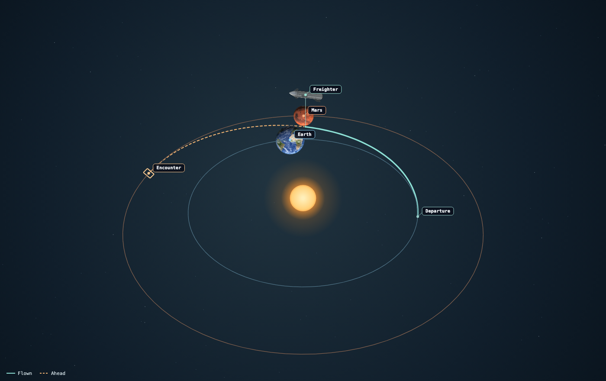</a> |

## Regenerate the assets

Run these commands from the repository root. Building the standalone models requires Python 3.9 or later and a C++17 compiler. The script calls `c++` by default and uses the Xcode Command Line Tools on macOS. Set `CXX` to select a different compiler.

```sh
python3 -m venv .venv
.venv/bin/python -m pip install -r requirements.txt
.venv/bin/python scripts/custom_assets/build.py
```

The default `build.py` command generates all groups listed under `--asset` and renders the PNGs at 12 samples per pixel. To preview the two greenhouse operating modes, use the command below. It writes the results to `build/greenhouse/`.

```sh
.venv/bin/python scripts/custom_assets/build.py --asset greenhouse --width 900 --samples 4 --out build/greenhouse
```

The scene renderer uses the Python standard library and Chrome or Chromium. The included textures and elevation data are sufficient for offline rendering. If `chromium`, `google-chrome`, or `chrome-headless-shell` is on your `PATH`, run the script directly.

```sh
python3 scripts/render_plates.py
```

Use `--chrome` or the `CHROME_BIN` environment variable to specify a browser executable. This example runs Google Chrome on macOS and writes the renders to `build/scenes/`.

```sh
python3 scripts/render_plates.py \
  --chrome '/Applications/Google Chrome.app/Contents/MacOS/Google Chrome' \
  --out build/scenes
```

To regenerate the input assets, run the [planet texture script](scripts/prepare_planets.py) or the [Mars terrain script](scripts/prepare_terrain.py). The terrain script requires internet access and `curl`. See the [asset catalog and credits](assets/README.md) for the original imagery and survey data sources.

### Regenerate the pwO3 cutaway

The cutaway uses five bodies from the local `pwO3_120mm_multicolor.3mf` teaching model. The coil body contains 16 separate windings. The other bodies are the vacuum vessel, blanket, first wall, and plasma. The generator adds a display deck, coil supports, and service hardware. The GLB records the source file's SHA-256 in its metadata.

Use Python 3.12 with the dependencies above, plus SciPy and VTK. Replace the example path with the location of your local 3MF file.

```sh
.venv/bin/python -m pip install scipy==1.16.3 vtk==9.3.1
.venv/bin/python scripts/custom_assets/stellarator_cutaway.py \
  --source /path/to/pwO3_120mm_multicolor.3mf \
  --out build/pwo3
```
