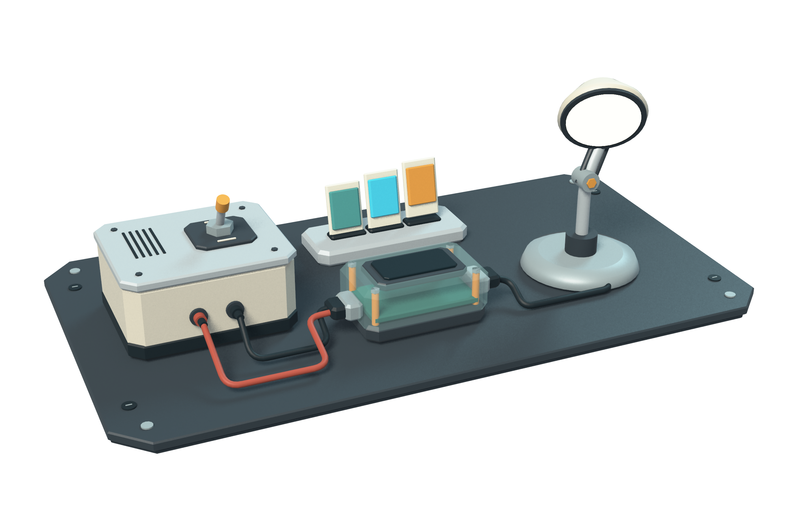
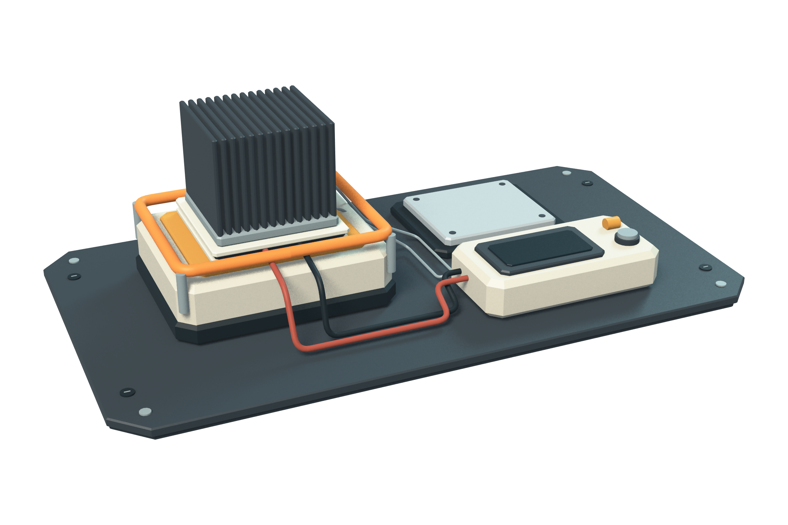
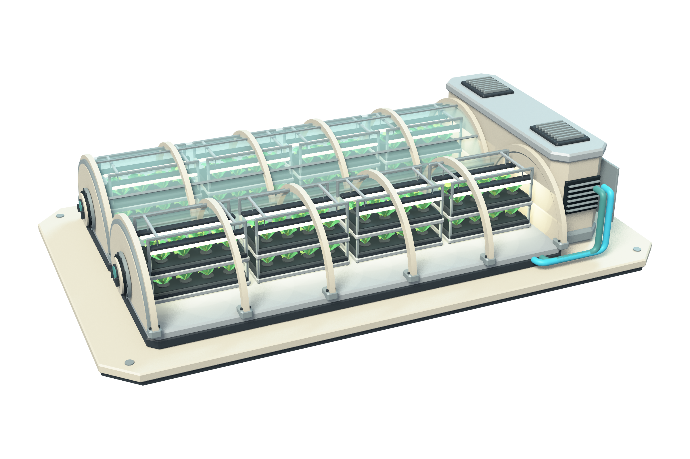
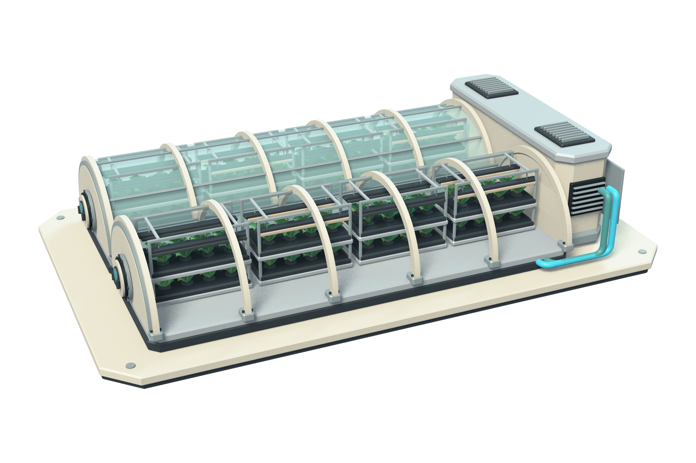
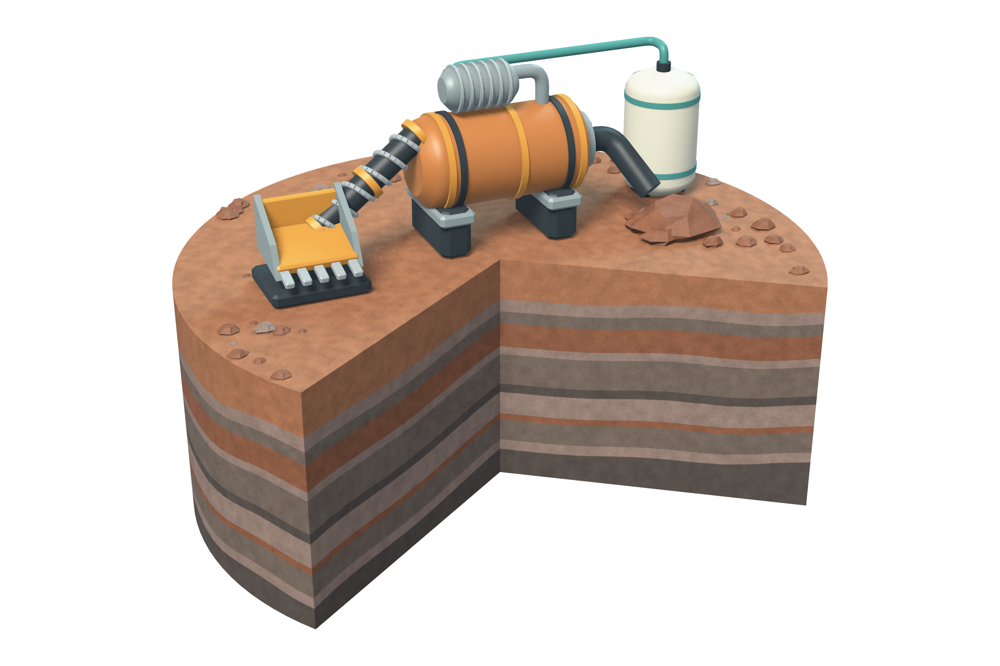
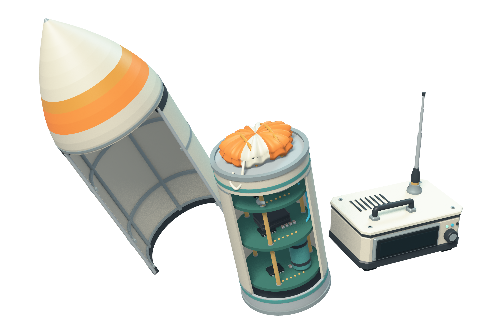
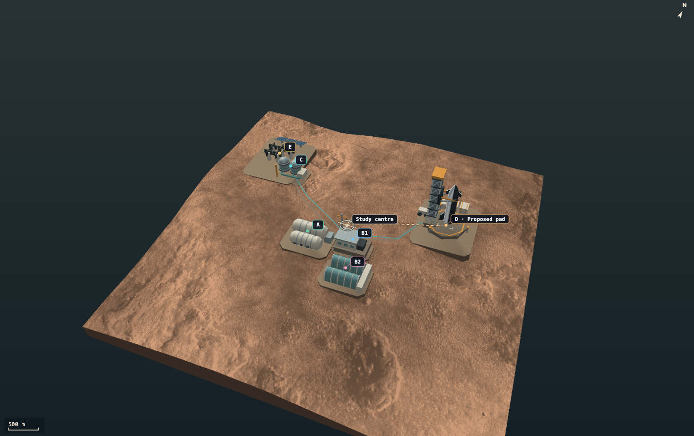
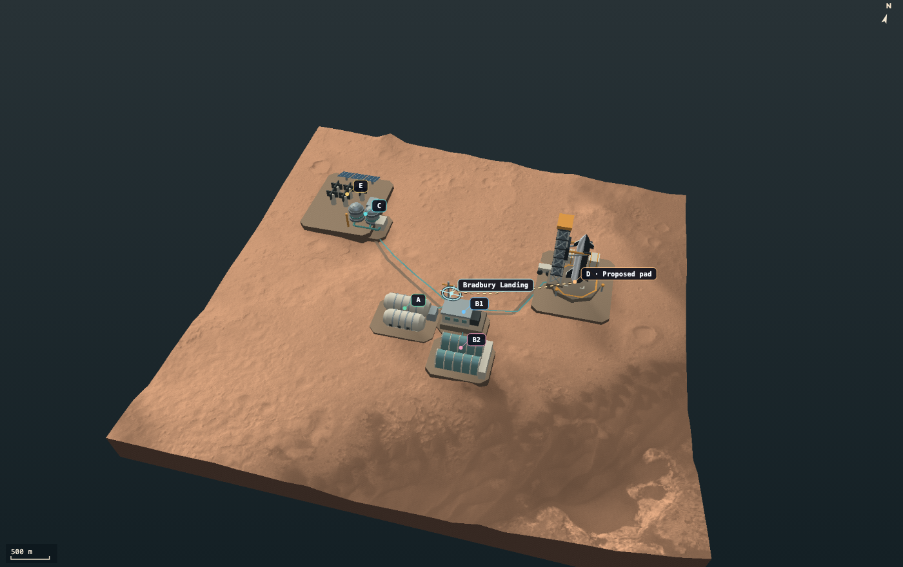
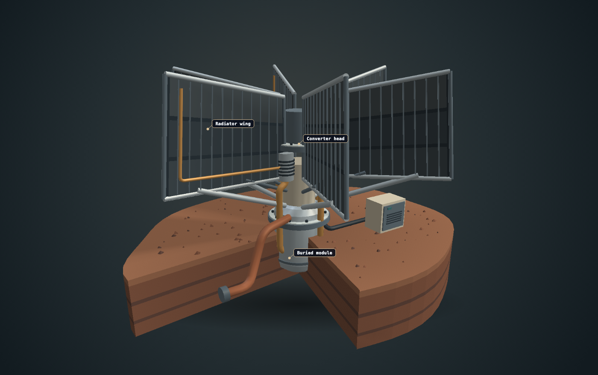
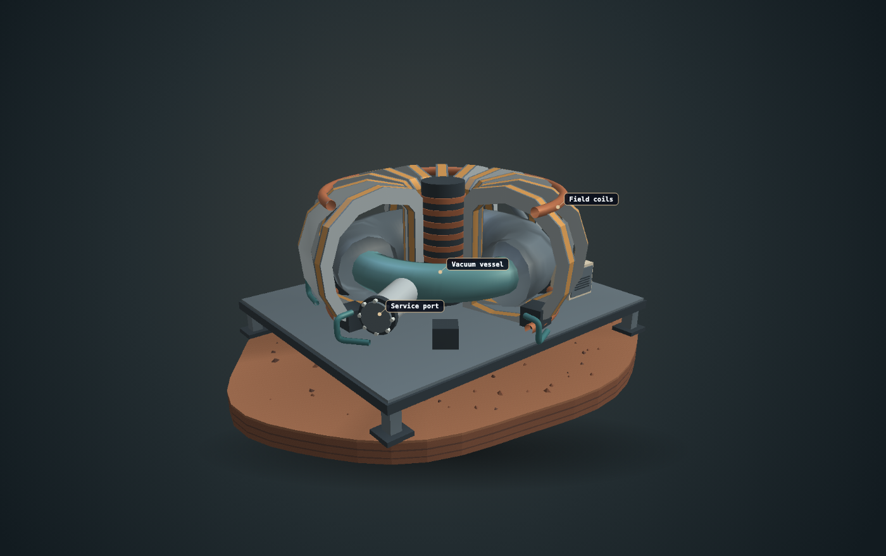

# MarsEnergy 3D

火星能源项目的程序化三维资产，包含 11 个 glTF 2.0 二进制模型、11 张对应的透明 PNG，以及 13 张基地、设备和货运场景渲染。

## 源码与产物

| 生成入口 | 输出目录 | 格式 |
| --- | --- | --- |
| [Python 建模与 C++ 渲染](scripts/custom_assets/) | [独立模型](assets/renders/custom/) | GLB 和 2400 × 1600 透明 PNG |
| [Chromium 场景渲染](scripts/render_plates.py)，使用 [JavaScript 场景源码](src/) | [场景原图](assets/renders/) | 1400 × 880 PNG |

### 独立模型

`--asset` 可重复指定。`greenhouse` 和 `geology` 各生成一对共用镜头的模型。

| `--asset` | 模型 | GLB | 图像 |
| --- | --- | --- | --- |
| `lamp` | 桌面发电套件，灯和仪表 | [模型](assets/renders/custom/p0_desk_kit_lamp_meter.glb) | <a href="assets/renders/custom/p0_desk_kit_lamp_meter.png"></a> |
| `teg` | 桌面发电套件，热电模块和散热器 | [模型](assets/renders/custom/p0_desk_kit_teg_heatsink.glb) | <a href="assets/renders/custom/p0_desk_kit_teg_heatsink.png"></a> |
| `greenhouse` | B2 温室剖面，25 kW / 12 h | [模型](assets/renders/custom/p0_b2_greenhouse_cutaway_25kw_12h.glb) | <a href="assets/renders/custom/p0_b2_greenhouse_cutaway_25kw_12h.png"></a> |
| `greenhouse` | B2 温室剖面，15 kW / 8 h | [模型](assets/renders/custom/p0_b2_greenhouse_cutaway_15kw_8h.glb) | <a href="assets/renders/custom/p0_b2_greenhouse_cutaway_15kw_8h.png"></a> |
| `microgrid` | 模块化微电网母线接口 | [模型](assets/renders/custom/p0_microgrid_bus_interface.glb) | <a href="assets/renders/custom/p0_microgrid_bus_interface.png"></a> |
| `cubesat` | CubeSat 1U 热电模块 | [模型](assets/renders/custom/p0_cubesat_1u_teg_module.glb) | <a href="assets/renders/custom/p0_cubesat_1u_teg_module.png"></a> |
| `backup` | A 区 48 h 备用电源剖面 | [模型](assets/renders/custom/p1_zone_a_backup_48h_cutaway.glb) | <a href="assets/renders/custom/p1_zone_a_backup_48h_cutaway.png"></a> |
| `geology` | C 区 Utopia 冰井 | [模型](assets/renders/custom/p1_zone_c_utopia_ice_well.glb) | <a href="assets/renders/custom/p1_zone_c_utopia_ice_well.png"></a> |
| `geology` | C 区 Gale 黏土窑 | [模型](assets/renders/custom/p1_zone_c_gale_clay_kiln.glb) | <a href="assets/renders/custom/p1_zone_c_gale_clay_kiln.png"></a> |
| `cansat` | CanSat 遥测演示 | [模型](assets/renders/custom/p1_cansat_rocket_telemetry.glb) | <a href="assets/renders/custom/p1_cansat_rocket_telemetry.png"></a> |
| `campus` | 园区停电演练沙盘 | [模型](assets/renders/custom/p2_campus_blackout_diorama.glb) | <a href="assets/renders/custom/p2_campus_blackout_diorama.png"></a> |

### 场景渲染

| 场景 | 图像 |
| --- | --- |
| 火星球体与 Utopia 选址 | <a href="assets/renders/01_mars_utopia_globe.png"></a> |
| Utopia 基地斜俯视图 | <a href="assets/renders/02_utopia_base_oblique.png"></a> |
| Utopia 基地四机组工况 | <a href="assets/renders/03_utopia_base_4units.png"></a> |
| Gale 基地与 Bradbury 着陆点 | <a href="assets/renders/04_gale_bradbury.png"></a> |
| 基地 B2 温室 | <a href="assets/renders/05_b2_greenhouse.png"></a> |
| P1 设备竖直构型 | <a href="assets/renders/06_p1_vertical.png"></a> |
| P1 设备伞形构型与沙尘工况 | <a href="assets/renders/07_p1_umbrella_dust.png"></a> |
| P2 布雷顿循环设备 | <a href="assets/renders/08_p2_brayton.png"></a> |
| DFR 电站 | <a href="assets/renders/09_dfr_station.png"></a> |
| 聚变电站 | <a href="assets/renders/10_fusion_station.png"></a> |
| D 区双臂塔架 | <a href="assets/renders/11_zone_d_tower.png"></a> |
| 货船剖面 | <a href="assets/renders/12_starship_cutaway.png"></a> |
| 地火霍曼转移轨道 | <a href="assets/renders/13_hohmann_transfer.png"></a> |

## 重新生成

以下命令在仓库根目录运行。独立模型需要 Python 3.9 或更新版本及支持 C++17 的编译器。默认调用 `c++`，macOS 使用 Xcode Command Line Tools，也可通过 `CXX` 指定编译器。

```sh
python3 -m venv .venv
.venv/bin/python -m pip install -r requirements.txt
.venv/bin/python scripts/custom_assets/build.py
```

默认生成全部模型，PNG 按每像素 12 次采样渲染。下面的命令预览温室的两种工况，结果写到 `build/greenhouse/`。

```sh
.venv/bin/python scripts/custom_assets/build.py --asset greenhouse --width 900 --samples 4 --out build/greenhouse
```

场景渲染使用 Python 标准库和 Chrome 或 Chromium。随附的纹理与高程数据可直接用于离线渲染。如果浏览器以 `chromium`、`google-chrome` 或 `chrome-headless-shell` 的名称加入了 `PATH`，可直接运行脚本。

```sh
python3 scripts/render_plates.py
```

也可以通过 `--chrome` 或环境变量 `CHROME_BIN` 指定浏览器可执行文件。下面的命令使用 macOS 上的 Google Chrome，将结果写入 `build/scenes/`。

```sh
python3 scripts/render_plates.py \
  --chrome '/Applications/Google Chrome.app/Contents/MacOS/Google Chrome' \
  --out build/scenes
```

如需重新加工行星纹理或火星地形，可分别运行 [行星纹理脚本](scripts/prepare_planets.py) 和 [地形加工脚本](scripts/prepare_terrain.py)。地形加工需要联网和 `curl`。原图、测绘数据的来源和署名见 [素材说明](assets/README.md)。
