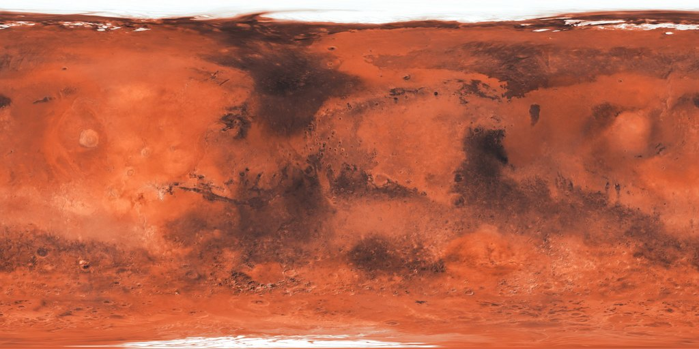

# 素材目录与署名

## 行星纹理

| 地球（含云层） | 火星 |
|---|---|
|  |  |
| [earth.jpg](planets/earth.jpg) | [mars.jpg](planets/mars.jpg) |

成品为 1024 × 512 的经纬度展开图，适合贴到球体上。经度横向展开，北极在上。球面光照、边缘散射和相机视角由货运场景在绘制时计算。

原图由 **Solar System Scope / INOVE** 提供，采用 **CC BY 4.0**。本项目保留三张 2048 × 1024 原始 JPEG，缩小两张行星图，并为地球叠加云层。复用时请保留作者、许可和加工说明。[纹理目录](https://www.solarsystemscope.com/textures/) · [CC BY 4.0](https://creativecommons.org/licenses/by/4.0/)

| 随附原图 | 下载来源 |
|---|---|
| [地球日照图](originals/planets/earth-day.jpg) | [2K Earth Day Map](https://www.solarsystemscope.com/textures/download/2k_earth_daymap.jpg) |
| [地球云图](originals/planets/earth-clouds.jpg) | [2K Earth Clouds](https://www.solarsystemscope.com/textures/download/2k_earth_clouds.jpg) |
| [火星地表图](originals/planets/mars.jpg) | [2K Mars](https://www.solarsystemscope.com/textures/download/2k_mars.jpg) |

## 火星地表与高程

| Gale | Arcadia | Utopia |
|---|---|---|
|  |  |  |
| [影像](terrain/gale.jpg) · [高程](../data/elevation/gale.json) | [影像](terrain/arcadia.jpg) · [高程](../data/elevation/arcadia.json) | [影像](terrain/utopia.jpg) · [高程](../data/elevation/utopia.json) |
| 4.5895° S，137.4417° E | 39° N，188° E | 46° N，117° E |

每组文件覆盖同一块约 6 × 6 km 的区域，北在上、东在右。JPEG 是 768 × 768 的灰度影像。JSON 是 25 行 × 25 列的高程采样点，行从北到南、列从西到东，间距 250 m，单位为相对火星高程基准面的米。中心点使用从零计数的 [12][12]。地形的红褐色着色、垂直夸张和基地模型在运行时叠加。

- **影像**使用 Esri 托管的 OnMars/CTX1 服务，按选址拼接第 12 级瓦片并裁切。数据署名为 **NASA/JPL/MSSS/The Murray Lab，地图服务由 Esri 提供**。[实际取图服务及署名](https://astro.arcgis.com/arcgis/rest/services/OnMars/CTX1/MapServer?f=pjson) · [Murray Lab CTX 项目](https://murray-lab.caltech.edu/CTX/V01/TilePages/)
- **Gale 高程**来自 USGS/JPL Mars MSL Gale Merged DEM 1m v3，按所需扫描行从源 GeoTIFF 读取像元。窗口中心是好奇号的 Bradbury Landing。图中的 D 区位于其东偏北约 1.67 km，是拟建设施。[USGS 产品说明](https://astrogeology.usgs.gov/search/map/mars_msl_gale_merged_dem_1m) · [原始 GeoTIFF](https://asc-pds-services.s3.us-west-2.amazonaws.com/mosaic/Mars/MSL/MSL_Gale_DEM_Mosaic_1m_v3.tif)
- **Arcadia 和 Utopia 高程**来自 NASA PDS 的 MGS MOLA MEGDR，原始分辨率为 128 像素/度。脚本分别对 MEGT44N180HB 和 MEGT88N090HB 两个分幅做双线性插值。两处中心均为候选研究坐标。[Arcadia 分幅标签](https://pds-geosciences.wustl.edu/mgs/mgs-m-mola-5-megdr-l3-v1/mgsl_300x/meg128/megt44n180hb.lbl) · [Utopia 分幅标签](https://pds-geosciences.wustl.edu/mgs/mgs-m-mola-5-megdr-l3-v1/mgsl_300x/meg128/megt88n090hb.lbl)

文件夹随附了构建所需的三处影像裁片和高程网格。需要从测绘产品重新取样时，[地形加工脚本](../scripts/prepare_terrain.py) 会向相应的公开服务按需请求瓦片和数据片段。JPEG 重编码的字节结果还取决于 Pillow 和 JPEG 编码库版本，本次核对使用 Pillow 10.3.0。

设备、基地、双臂塔架和货船均为程序化概念模型。几何源文件和生成入口见[项目说明](../README.md#源码与产物)。
