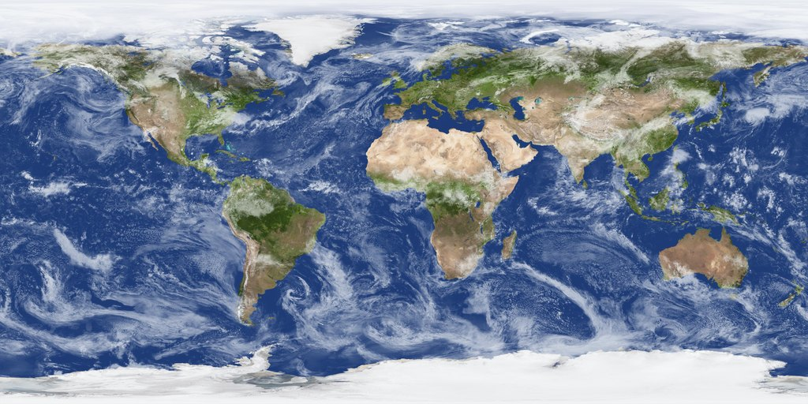
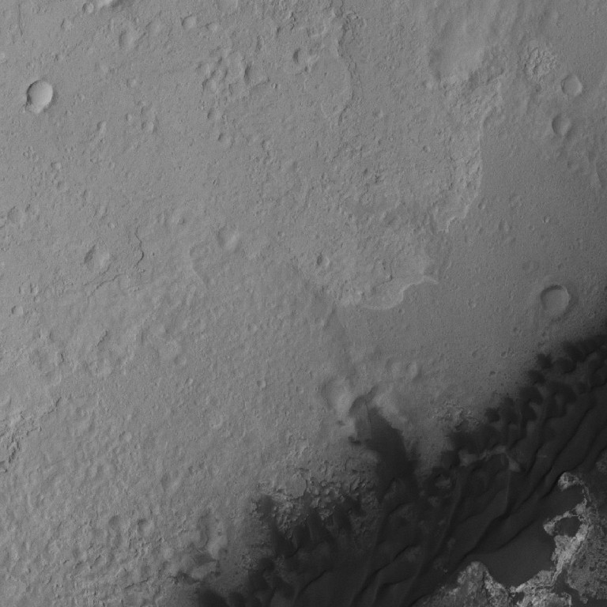
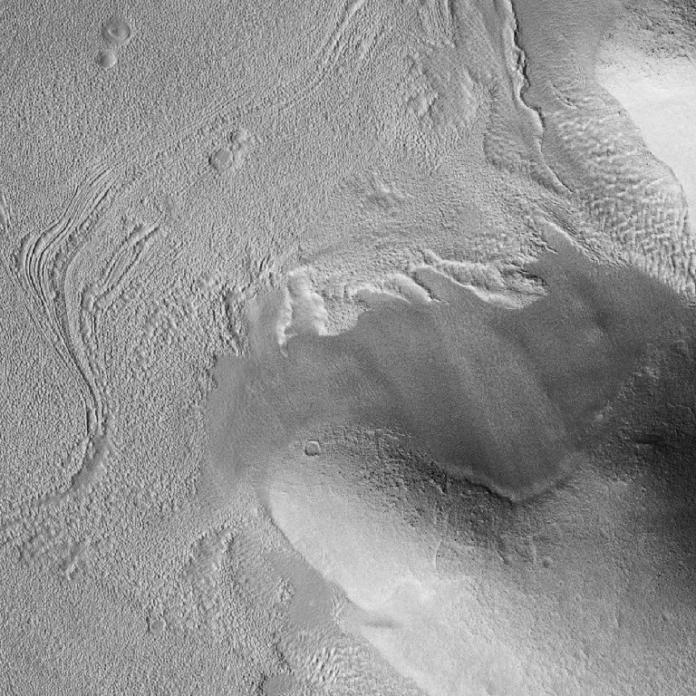
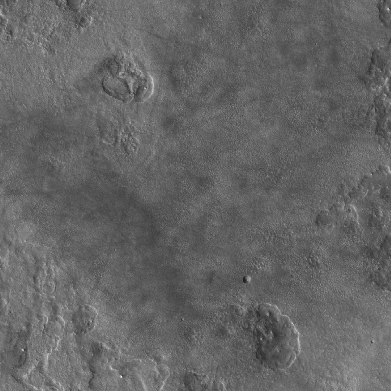

# Asset catalog and credits

## Planet textures

| Earth with cloud cover | Mars |
|---|---|
|  |  |
| [earth.jpg](planets/earth.jpg) | [mars.jpg](planets/mars.jpg) |

The 1024 × 512 textures use an equirectangular projection for mapping onto a sphere. Longitude runs horizontally, with the north pole at the top. The cargo scene calculates lighting, limb scattering, and the camera view at render time.

**Solar System Scope / INOVE** provides the original textures under **CC BY 4.0**. This repository includes the three original 2048 × 1024 JPEGs. The processed versions are downscaled, with a cloud layer composited onto Earth. When reusing the textures, retain the attribution, license, and description of the changes. [Texture catalog](https://www.solarsystemscope.com/textures/) · [CC BY 4.0](https://creativecommons.org/licenses/by/4.0/)

| Included original | Download source |
|---|---|
| [Earth day map](originals/planets/earth-day.jpg) | [2K Earth Day Map](https://www.solarsystemscope.com/textures/download/2k_earth_daymap.jpg) |
| [Earth cloud map](originals/planets/earth-clouds.jpg) | [2K Earth Clouds](https://www.solarsystemscope.com/textures/download/2k_earth_clouds.jpg) |
| [Mars surface map](originals/planets/mars.jpg) | [2K Mars](https://www.solarsystemscope.com/textures/download/2k_mars.jpg) |

## Mars imagery and elevation

| Gale | Arcadia | Utopia |
|---|---|---|
|  |  |  |
| [Imagery](terrain/gale.jpg) · [Elevation](../data/elevation/gale.json) | [Imagery](terrain/arcadia.jpg) · [Elevation](../data/elevation/arcadia.json) | [Imagery](terrain/utopia.jpg) · [Elevation](../data/elevation/utopia.json) |
| 4.5895° S, 137.4417° E | 39° N, 188° E | 46° N, 117° E |

At each site, the image and elevation grid cover the same roughly 6 × 6 km area, with north at the top and east on the right. Each JPEG is a 768 × 768 grayscale image. Each JSON file contains a 25 × 25 elevation grid sampled every 250 m. Rows run north to south and columns run west to east. Elevations are in meters relative to the Mars elevation datum, and the center sample is `[12][12]` with zero-based indexing. The renderer applies the reddish-brown tint and vertical exaggeration and adds the base models at runtime.

- **Imagery** comes from the Esri-hosted OnMars/CTX1 service. The script stitches zoom level 12 tiles and crops them to each site. Imagery credit goes to **NASA/JPL/MSSS/The Murray Lab**. Esri provides the map service. [Map service and attribution](https://astro.arcgis.com/arcgis/rest/services/OnMars/CTX1/MapServer?f=pjson) · [Murray Lab CTX project](https://murray-lab.caltech.edu/CTX/V01/TilePages/)
- **Gale elevation** comes from the USGS/JPL Mars MSL Gale Merged DEM 1m v3. The script reads the required scanlines from the source GeoTIFF. The area is centered on Curiosity's Bradbury Landing site. Zone D is a proposed facility about 1.67 km to the east and slightly north of the landing site. [USGS product description](https://astrogeology.usgs.gov/search/map/mars_msl_gale_merged_dem_1m) · [Original GeoTIFF](https://asc-pds-services.s3.us-west-2.amazonaws.com/mosaic/Mars/MSL/MSL_Gale_DEM_Mosaic_1m_v3.tif)
- **Arcadia and Utopia elevation** comes from the NASA PDS MGS MOLA MEGDR dataset at 128 pixels per degree. The script samples tiles MEGT44N180HB and MEGT88N090HB, respectively, using bilinear interpolation. The center coordinates are candidate study sites. [Arcadia tile label](https://pds-geosciences.wustl.edu/mgs/mgs-m-mola-5-megdr-l3-v1/mgsl_300x/meg128/megt44n180hb.lbl) · [Utopia tile label](https://pds-geosciences.wustl.edu/mgs/mgs-m-mola-5-megdr-l3-v1/mgsl_300x/meg128/megt88n090hb.lbl)

The build uses the image crops and elevation grids included for all three sites. To resample the source data, run the terrain preparation script. It requests tiles and data ranges from the public services as needed. JPEG output can vary with the versions of Pillow and the JPEG encoder. The reference check used Pillow 10.3.0. [Terrain preparation script](../scripts/prepare_terrain.py)

The equipment, bases, twin-arm tower, and freighter are procedural concept models. The project README links to the geometry sources and generators. [Source and outputs](../README.md#source-and-outputs)
